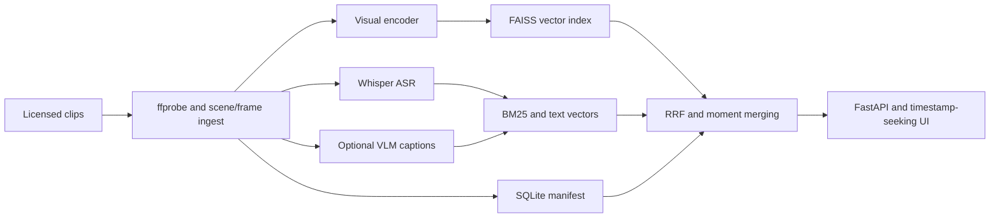

# Video Understanding Search

Search videos with natural language and retrieve **timestamped moments**, not just filenames.

[](https://github.com/DanyVX/video-understanding-search/actions/workflows/ci.yml)
[](LICENSE)

## Demo

**TBD (not yet recorded).** M0 provides diagnostics only; no video retrieval or UI exists yet.
Do not interpret screenshots from a design mock-up as a working demo.

## Key results

<!-- RESULTS START -->
| Metric | Result |
| --- | --- |
| Video Recall@5 | TBD (not yet measured) |
| Moment Recall@5 (tIoU >= 0.5) | TBD (not yet measured) |
| Search latency p95 | TBD (not yet measured) |
| Index size per video-hour | TBD (not yet measured) |
<!-- RESULTS END -->

The table is maintained by `python scripts/render_results.py`. No benchmark claims are made
until `results/*.json` contains reproducible measurements.

## Why this exists

A video can contain the relevant action for only a few seconds. Keyword search over
filenames cannot reliably locate those moments. This project will combine visual
similarity, ASR transcripts and optional captions to return time ranges with a
traceable retrieval evaluation. Scope is short, properly licensed clips, not a video platform.

## Architecture



Each stage after environment diagnostics is **planned**, not implemented.

## Quickstart

Python 3.11 or 3.12 is recommended; this package also supports 3.13. On a fresh clone:

```sh
python -m pip install -e ".[dev]"
python -m vsearch doctor --json
python scripts/tasks.py test-fast
```

If `uv` is present, `python scripts/tasks.py setup` uses it. Run
`python scripts/tasks.py lint`, `typecheck`, and `test` before PRs.
No GPU, video downloads or third-party model files are required for M0.

## Usage examples

```sh
vsearch version
vsearch doctor
vsearch doctor --json --check-network
python scripts/tasks.py bench
```

`bench` currently runs a **diagnostic smoke check**, not a performance measurement.
Ingestion and `vsearch search` will be introduced in later milestones.

## Configuration

Copy `.env.example` to `.env` and edit the `VSEARCH_` settings. Settings are
validated at startup. Caption API spending is disabled (0 USD) by default.
Private media and generated indexes must stay outside version control.

## How to reproduce benchmarks

See [evaluation protocol](docs/EVAL_PROTOCOL.md), [results](docs/RESULTS.md),
and [data policy](DATA.md). M7 will add benchmark scripts which write
`results/*.json` with timestamps, hardware, installed library versions, git
revision, confidence intervals, and exact commands. There are no benchmark results yet.

## Design decisions

CPU-first development with SQLite metadata and a FAISS local vector-index interface.
See [design and decision log](docs/DESIGN.md). M0 does not download any model.

## Limitations

M0 is scaffolding and a diagnostic CLI, **not** video understanding or search.
See [limitations](docs/LIMITATIONS.md) and [model card](MODEL_CARD.md).

## Roadmap

- M1: resilient, checkpointed video ingestion
- M2: versioned visual embeddings and frame-to-moment retrieval
- M3: Whisper transcripts with timestamped text indexing
- M4: optional capped-cost captions
- M5: hybrid retrieval, merging, ranking and diagnostics
- M6: safe API and browser video seeking
- M7: >= 100 annotated queries on >= 20 licensed clips, ablations and confidence intervals
- M8: documented demo and verified tagged release

## License

Source code: [MIT](LICENSE). Media and pretrained models retain their **own**
terms. No permission to reuse a video or model is implied by the MIT code license.

## Acknowledgements and citations

Planned components include [OpenCLIP](https://github.com/mlfoundations/open_clip),
[FAISS](https://github.com/facebookresearch/faiss),
[faster-whisper](https://github.com/SYSTRAN/faster-whisper),
and [BM25S](https://github.com/xhluca/bm25s). Verify licenses before using
individual artifacts; see [MODEL_CARD.md](MODEL_CARD.md).
