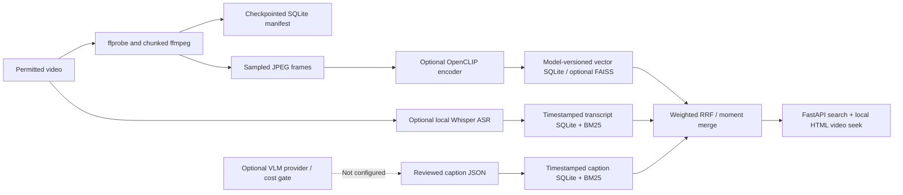

# Video Understanding Search

Natural-language search over **timestamped moments** in local videos, combining optional
OpenCLIP visual vectors with Whisper speech transcripts through weighted reciprocal-rank fusion.

[](https://github.com/DanyVX/video-understanding-search/actions/workflows/ci.yml)
[](LICENSE)

## Demo

A **reproducible generated demo** is available via `scripts/generate_demo.py`.
No third-party clips, voices or personal footage are required. A recorded GIF is
**TBD (not yet recorded)**; the demo is a real local command sequence, not a mock screenshot.

## Key results

<!-- RESULTS START -->
| Metric | Result |
| --- | --- |
| Video Recall@5 | TBD (not yet measured) |
| Moment Recall@5 (tIoU >= 0.5) | TBD (not yet measured) |
| Search latency p95 | TBD (not yet measured) |
| Index size per video-hour | TBD (not yet measured) |
<!-- RESULTS END -->

**No real-video accuracy numbers are claimed.** A separate 20-record, 110-query
**synthetic text-index smoke** can measure execution correctness and latency,
but it does not measure video semantic understanding. Do not copy its scores
into this results table. The table is generated by `scripts/render_results.py`
from an appropriately sourced, explicitly measured real evaluation record.

## Why this exists

Finding a short action or line of speech inside a video requires time-localized
retrieval. Video filenames alone cannot locate moments. This research implementation
supports repeatable single-machine indexing, speech-only search without a GPU,
and optional heavy visual embeddings. It is **not** a hosted video platform.

## Architecture



Caption generation has a provider protocol, dry-run cost checking and a frame/model/prompt
cache. An independent caption BM25 index is implemented, populated via validated
manual-caption JSON imports; no live VLM provider is configured.
FAISS is an optional acceleration path, not a separate always-running service.

## Quickstart

Python 3.11/3.12, ffmpeg and ffprobe (for media ingestion). No GPU or model
weights are required for diagnostics and deterministic tests.

```sh
git clone https://github.com/DanyVX/video-understanding-search.git
cd video-understanding-search
python -m pip install -e ".[dev]"
python -m vsearch doctor
python scripts/tasks.py test-fast
```

For a visual-only generated demonstration, create local footage and ingest it.
The demo has **no spoken audio**, so speech queries require your own licensed,
permissioned audio-containing clip and separately indexed transcripts.

```sh
python scripts/generate_demo.py --output .vsearch/incoming --count 3
python -m vsearch ingest .vsearch/incoming/synthetic-00-red.mp4 --keep-source
python -m vsearch videos
python -m vsearch serve
```

Then open `http://127.0.0.1:8000`. The `--keep-source` opt-in stores the local
path (not a copy) so the browser can seek into the original video. Omitting it
disables browser playback by design. The API is intentionally **loopback only**;
do not expose it on the public internet.

## Usage examples

Text search needs a speech transcript. Index an approved local Whisper model
after installing the optional dependency and **pre-downloading weights yourself**:

```sh
python -m pip install -e ".[asr]"
python -m vsearch transcribe VIDEO_ID
python -m vsearch search "someone mentions the laptop"
```

Visual similarity requires OpenCLIP and opt-in model weights. Check the model
terms and weight size before downloading:

```sh
python -m pip install -e ".[vision]"
python -m vsearch index-visual VIDEO_ID
python -m vsearch search "a person opens a laptop" --visual
```

`VIDEO_ID` is returned by `vsearch ingest` or `vsearch videos`.
The text, caption and visual search paths can be fused after their respective
channels are indexed. Import reviewed caption JSON with
`python -m vsearch caption-import captions.json` where captions.json contains
`{"video_id":"...","model_key":"manual-v1","segments":[{"start":1,"end":3,"text":"a laptop opens"}]}`.
For local HTTP use:

```sh
python -m vsearch serve
```

- `POST /v1/search`: JSON `{"query":"...", "limit":10, "include_visual":false}`
- `GET /v1/videos`, `GET /v1/videos/{id}/moments`
- `POST /v1/ingest`: `{"filename":"clip.mp4","keep_source":false}`;
  only files previously staged under `VSEARCH_DATA_DIR/incoming`
- `GET /v1/jobs/{id}`: in-process background-job status
- `GET /v1/media/{id}`: HTTP Range playback only when source retention was opted in
- `GET /v1/thumbnails/{video_id}/{frame_id}`
- `DELETE /v1/videos/{id}`: manifest, thumbnail and vector cleanup

There is **no public authentication or multi-user isolation**. Do not serve on
non-loopback interfaces or upload private footage to shared storage.

## Configuration

Copy `.env.example` to `.env`. Settings use validated `VSEARCH_` variables.
Default caption budget is zero. Video source retention defaults off. Generated
frames/indexes and datasets live outside git.

## How to reproduce benchmarks

```sh
python -m bench.smoke --output results/synthetic-smoke.json
python scripts/generate_demo.py --output data/synthetic --count 20
python -m eval.evaluate --queries path/to/licensed_annotations.json --output results/search_eval.json
python scripts/render_results.py --check
```

The smoke report records UTC time, git commit, hardware and library versions,
but it does **not** measure CLIP, Whisper, real content or model performance.
The final evaluation requires >= 20 legitimately licensed videos, >= 100
human-annotated moment queries, validation tuning, second-reader checks and
ablation measurements. Those are **not yet completed**. See
[protocol](docs/EVAL_PROTOCOL.md), [results](docs/RESULTS.md) and [failures](docs/FAILURE_ANALYSIS.md).

## Design decisions

SQLite as the manifest source of truth, exact local vector search with optional
FAISS, lazy model loading, M1 chunk-level checkpoints and weighted RRF avoid
unnecessary services. See [decision log](docs/DESIGN.md).

## Limitations

Uniform frame sampling with a sample-level scene-change heuristic is not
full PySceneDetect, visual weights are optional, captions require manually reviewed imports (no live caption model), and evaluation currently lacks a real annotated dataset.
See [limitations](docs/LIMITATIONS.md) and [model card](MODEL_CARD.md).

## Roadmap

- [x] M0: strict tooling, environment capture and reproducible baseline
- [x] M1: chunked, resumable sampling, thumbnails and manifest
- [x] M2: visual encoder interface, versioned vector store and moment clustering
- [x] M3: optional Whisper adapter, transcript windows and SQLite BM25
- [x] M4: optional budgeted caption interface and content-hash cache
- [x] M5: rank fusion and moment merge
- [x] M11: caption SQLite retrieval and validated JSON import
- [x] M6: local search API/UI, media seeking and derived-artifact erase path
- [x] M7 (partial): evaluation metrics, JSON runner and synthetic tests
- [ ] M7 (real validation): authorized corpus, human annotations, full ablations
- [ ] M8 (release): real demo recording and benchmark-verified semver tag

## License

The **source code** is MIT licensed. Pretrained models and input data have
independent terms and must be checked individually. No real media is committed.

## Acknowledgements and citations

[OpenCLIP](https://github.com/mlfoundations/open_clip),
[faster-whisper](https://github.com/SYSTRAN/faster-whisper),
[FAISS](https://github.com/facebookresearch/faiss),
[PySceneDetect](https://www.scenedetect.com/) (not yet integrated),
and [FastAPI](https://fastapi.tiangolo.com/).
